# demo-40Pin-HAT —— Waveshare HAT × Quectel Pi 适配总览

> 本仓库汇总 Waveshare 外设 HAT 与 40Pin 基础外设（GPIO / PWM / UART / CAN）在 Quectel Pi 系列开发板
> （L1 / M1 / H1 / M2）上的适配与测试：
> HAT 的 SDK 源码保持统一，板型差异只放在对应的一键脚本里；离线依赖、公共函数与测试脚本共用。
> 每个 HAT 的详细说明（接线、排错、实测数据）在该 HAT 目录下的 **README_<板>.md**。
> 原厂 PDF、原理图、源码压缩包体积较大，不在本仓库发布，各 README 中保留了文件清单以便对照。

---

## 1. 支持的开发板

| 板 | 平台 | 系统 | 板上环境 / 备注 |
|---|---|---|---|
| Quectel Pi L1 | QCM2290（Qualcomm Scuba） | QTI Linux（Yocto 类，非 Debian）/ Android | 无 dpkg / gcc；40Pin SPI 用 `40Pin-ctrl` 使能；C 例程走 `prebuilt/` 静态二进制 |
| Quectel Pi M1 | SM6115（Qualcomm BENGAL） | QTI Linux（Yocto 类，非 Debian）/ Android | 无 dpkg / gcc；40Pin SPI 用 `40Pin-ctrl` 使能；C 例程走 `prebuilt/` 静态二进制 |
| Quectel Pi H1 | QCS6490 | Debian 13（trixie）/ Android | 有 gcc / make；40Pin SPI 用 `qpi-config` 使能 `spi10` |
| Quectel Pi M2 | RK3576 | Debian 13（GNOME 桌面）/ Android | 有 gcc / make；40Pin SPI 用 `qpi-config` 使能 `spi1` |

> **Android 系统**：脚本已按 mksh 和 `/data/local/tmp` 环境适配，必须用 `sh <脚本>` 执行
> （Android 自带 mksh，没有 bash），并以 root 身份运行（如先执行 `adb root`）。

## 2. 支持的外设与 HAT

### 2.1 外设适配总览（实物图）

> 下表所列外设均已在 Quectel Pi 系列开发板上验证；产品名称可点击跳转到购买页面。

#### 🖥️ 显示与交互类 HAT

| 实物图 | 外设 | 接口 | 说明 |
|---|---|---|---|
| 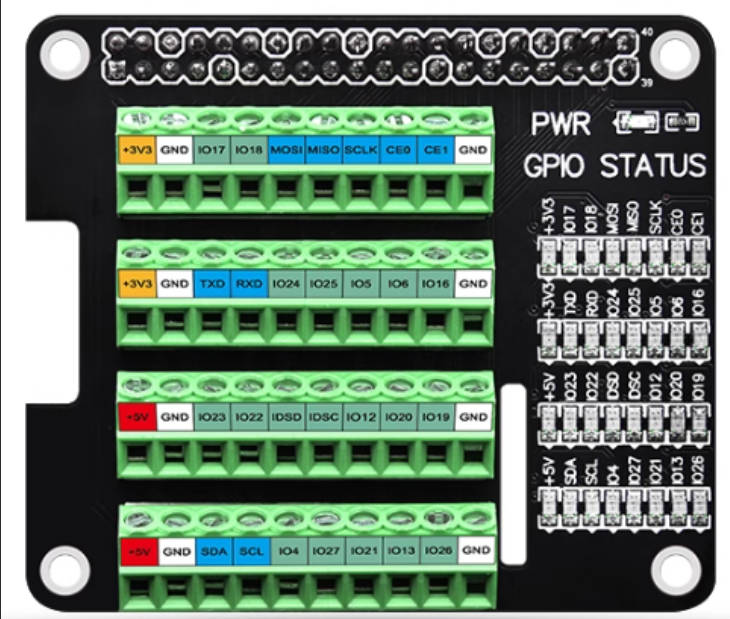 | [GPIO terminal expansion board](https://developer.quectel.com/wp-content/uploads/2025/11/SMP0104-%E6%A0%91%E8%8E%93%E6%B4%BEGPIO%E7%AB%AF%E5%AD%90%E6%89%A9%E5%B1%95%E6%9D%BF-%E9%BB%91%E8%89%B2%E7%8E%AF%E4%BF%9D.pdf) | GPIO | — |
| 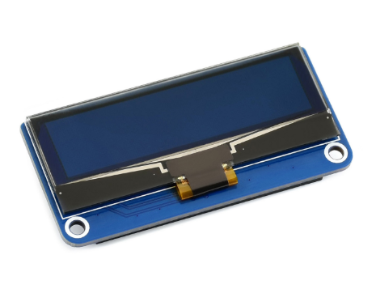 | [2.23 寸 OLED 扩展板](https://www.waveshare.net/shop/2.23inch-OLED-HAT.htm) | SPI | 杜邦线连对应引脚可以，<br>直接扣在 40Pin 上存在问题 |
| 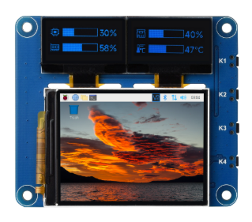 | [三联屏彩屏扩展板](https://www.waveshare.net/shop/OLED-LCD-HAT-A.htm) | SPI / I2C | 支持清晰、鲜艳的图像显示，<br>适用于各种应用场景 |

#### 🌡️ 传感器与环境感知类 HAT

| 实物图 | 外设 | 接口 | 说明 |
|---|---|---|---|
| 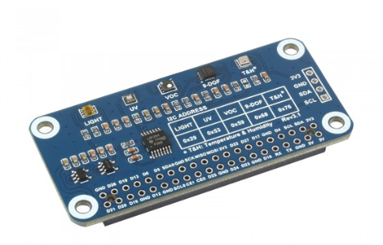 | [环境传感器扩展板](https://www.waveshare.net/shop/Environment-Sensor-HAT.htm) | I2C | 可见光感应、环境感应、运动姿态感应、红紫外感应、气体感应 |

#### 🤖 电机与机器人控制类 HAT

| 实物图 | 外设 | 接口 | 说明 |
|---|---|---|---|
| 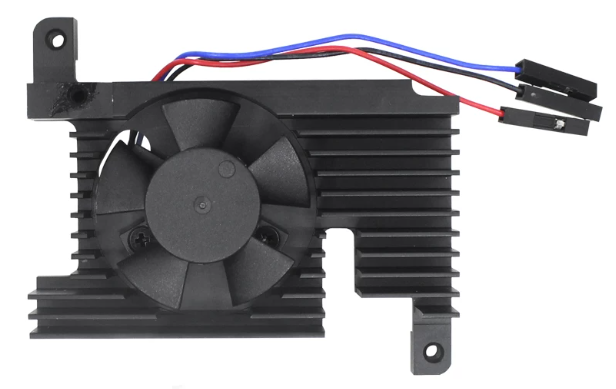 | [CPU cooling fan](https://item.taobao.com/item.htm?id=1060075638198&amp;mi_id=0000p30p9EbZLZc_STjz_b8WglyjAjh5SUr28KdB0HuAIb0&amp;skuId=6270052682832&amp;spm=tbpc.boughtlist.suborder_itemtitle.1.62172e8dHIKOeb) | PWM | 可用于 CPU 散热 |
| 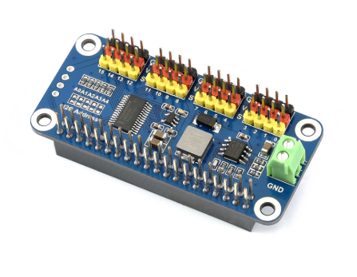 | [16 路 PWM 舵机驱动板<br>模块](https://www.waveshare.net/shop/Servo-Driver-HAT.htm) | I2C | 可控制 16 路舵机，每路 12 位分辨率，<br>适合机械臂、六足等机器人舵机驱动 |
| 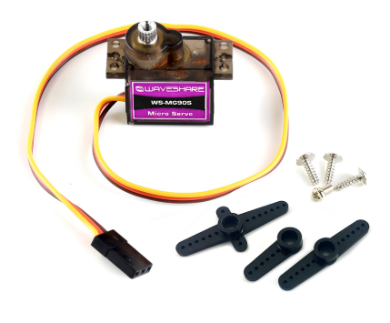 | [MG90S 舵机](https://www.waveshare.net/shop/MG90S-Servo.htm) | PWM | — |

#### 📡 通信与网络连接类 HAT

| 实物图 | 外设 | 接口 | 说明 |
|---|---|---|---|
| 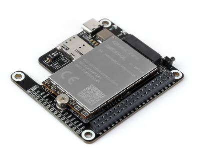 | [PCIe 转 5G/4G/3G<br>扩展板套件](https://www.waveshare.net/shop/RM520N-GL-5G-HAT-Plus.htm) | 板上 PCIe<br>+ 40Pin GPIO | PCIe 协议，支持 5G 高速上网 |
| 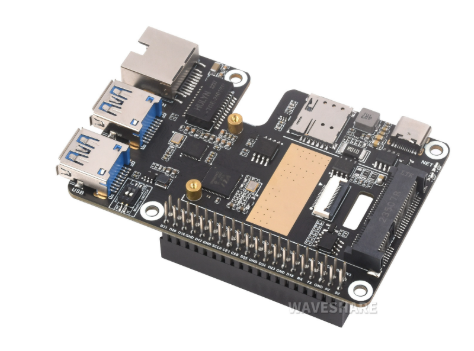 | [PCIe 转千兆以太网<br>和 USB 3.2 Gen1 扩展卡](https://www.waveshare.net/shop/PCIe-TO-MiniPCIe-GbE-USB3.2-HAT-Plus.htm) | — | PCIe 转 MiniPCIe 4G、<br>千兆以太网和 USB 3.2 Gen1 |
| 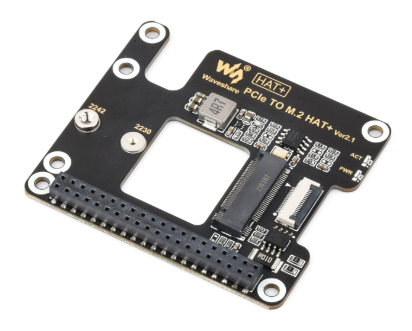 | [PCIe 转 M.2 转接板](https://www.waveshare.net/shop/PCIe-TO-M.2-HAT-Plus.htm) | — | NVMe 协议 M.2 接口硬盘，<br>高速读写 |
| 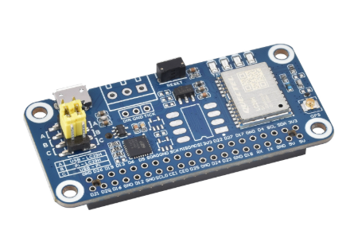 | [GPS 模块（LC29H）](https://www.waveshare.net/shop/LC29H-AA-GPS-HAT.htm) | UART / I2C / GPIO | 弥补 Pi M2 没有 GNSS 的短板：<br>RTK 厘米级高精度定位，<br>支持多卫星系统并发接收、<br>多频主动干扰消除、AGNSS |

#### 🎵 音频处理类 HAT

> 不建议适配：QPi 系列开发板目前均有音频内置 Codec。

#### 🔧 拓展接口类 HAT

| 实物图 | 外设 | 接口 | 说明 |
|---|---|---|---|
| 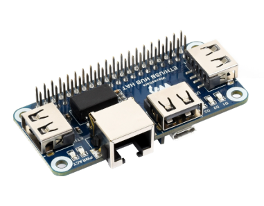 | [以太网 USB 集线器扩展板<br>（USB HUB）](https://www.waveshare.net/shop/ETH-USB-HUB-HAT.htm) | 5V / GND | 丰富 QPi 的以太网和 USB 接口：<br>RJ45 网口 × 1，USB 2.0 接口 × 3 |
| 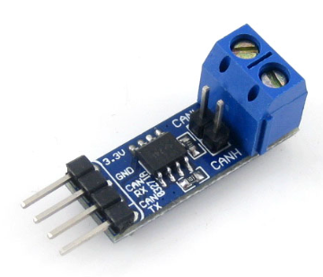 | [SN65HVD230<br>CAN 通信模块](https://www.waveshare.net/shop/SN65HVD230-CAN-Board.htm) | CAN（仅 M2） | CAN 总线发送接收器，<br>引脚兼容 PCA82C250，<br>3.3V 供电，带 ESD 保护 |
| 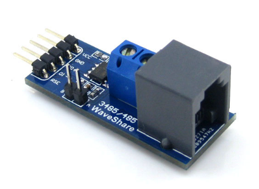 | [RS485 UART 转 485 模块<br>（3.3V / 5V 电平）](https://www.waveshare.net/shop/RS485-Board-3.3V.htm) | UART | 基于 3.3V 或 5V 系统的 RS485 通信，<br>支持多种通信总线接口 |
| 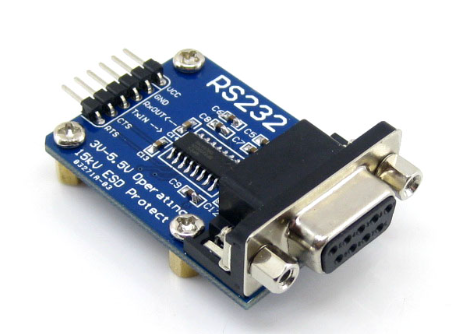 | [RS232 转串口<br>UART TTL 模块](https://www.waveshare.net/shop/RS232-Board.htm) | UART | RS232 发送接收器，带 ESD 保护，<br>支持流控制 |

### 2.2 HAT 适配状态

| HAT | 总线 | 适配 SDK | 一键脚本 | 详细文档 |
|---|---|---|---|---|
| 2.23inch OLED HAT | SPI（SSD1305，128×32） | `QPi_2.23inch_OLED_HAT_SDK` | `<板>_2.23inch-OLED-HAT.sh` | `2.23inch-OLED-HAT/README_<板>.md` |
| Environment Sensor HAT（SKU 20471） | I2C（BME280 / TSL2591 / LTR-390UV / SGP40 / ICM20948） | `QPi_Environment_Sensor_HAT_SDK` | `<板>_Environment-Sensor-HAT.sh` | `Environment-Sensor-HAT/README_<板>.md` |
| Servo Driver HAT（PCA9685，16 路舵机） | I2C（Pin3/5 或 Pin27/28） | 无（直接操作 `/dev/i2c-*`） | `M2_pca9685-servo.sh`（仅 M2） | `Servo-driver-HAT/README.md` |
| ETH/USB HUB HAT（FE1.1S + RTL8152B） | USB 2.0（40Pin 只取 5V/GND） | 无（内核 `hub` / `r8152` 免驱） | 无 | `ETH-USB-HUB-HAT/README.md` |
| OLED/LCD HAT (A) | SPI（ST7789VW，2inch LCD）+ I2C（SSD1315，0.96 OLED ×2）+ 4 按键 | `QPi_OLED_LCD_HAT_SDK` | `M2_OLED-LCD-HAT.sh`（仅 M2） | `OLED-LCD-HAT/README_M2.md` |
| LC29H(XX) GPS/RTK HAT | UART（Pin8/Pin10，115200 8N1）+ PPS（Pin12） | 无（直接读写 `/dev/ttyS1`） | `M2_LC29H-GPS-RTK-HAT.sh`（仅 M2） | `LC29H(XX)-GPS-RTK-HAT/README_M2.md` |

各板适配状态：

| HAT | L1 | M1 | H1 | M2 |
|---|---|---|---|---|
| 2.23inch OLED HAT | 实测通过 | 实测通过 | 实测通过 | 实测通过 |
| Environment Sensor HAT | 实测通过 | 实测通过 | 实测通过 | 实测通过 |
| Servo Driver HAT | — | — | — | 实测通过 |
| ETH/USB HUB HAT | — | — | — | 实测通过 |
| OLED/LCD HAT (A) | 未适配 | 未适配 | 未适配 | 实测通过 |
| LC29H(XX) GPS/RTK HAT | — | — | — | 实测通过 |

## 3. 40Pin 基础外设测试

| 目录 | 测试内容 | 覆盖板 | 依赖 | 接线 / 判定 |
|---|---|---|---|---|
| `40Pin-GPIO/` | `<板>_pin_control.sh`：对 40Pin 上 28 个 GPIO 引脚做 `up` / `down` / `get`，支持 `pinN` 或 `all` | L1 / M1 / H1 / M2 | libgpiod v2（`gpioset` / `gpioget`） | 无需外部接线；已被 I2C / UART / SPI / PWM 占用的引脚会报 `Device or resource busy` |
| `40Pin-PWM/` | `<板>_pwm-test.sh`：Pin33 输出 1 kHz / 50% PWM，另一 GPIO 捕获边沿，判定 900–1100 Hz、40–60% 占空比 | L1 / M1 / M2（H1 暂无） | libgpiod v2（`gpiomon`）、`timeout`、`awk`、`sed` | Pin33 → Pin31（默认）；也可改 Pin29 |
| `40Pin-UART/` | `<板>_uart-loopback.sh`：Pin8 TXD 与 Pin10 RXD 短接，逐档波特率回环比对 32 字节图案 | L1 / M1 / H1 / M2 | `stty`、`dd`、`cmp`、`od`、`timeout` | Pin8 ↔ Pin10 短接；7 档波特率（9600～1500000）全部 PASS 才算通过 |
| `40Pin-CAN/` | `M2_can-loopback.sh`：can0 控制器回环 / 静默回环，发送 5 帧并比对 `rx_packets` 增量 | M2 | `ip`、can-utils（`candump` / `cansend`）或 `/data/local/tmp/cantool` | 单板 + 一块 SN65HVD230 即可；脚本输出 `RESULT: PASS / FAIL` |

> 这几组测试脚本直接操作内核设备节点，需要以 root 运行；`packages/` 中**不含** libgpiod，
> 板上需已具备 libgpiod v2 的 `gpioset` / `gpioget` / `gpiomon`。

> `40Pin-UART/M2_rs485-test.sh` 为 M2 专用 RS485 单向链路测试，接线与用法见 3.5。

### 3.1 GPIO

```bash
cd 40Pin-GPIO
sudo ./L1_pin_control.sh pin18 up
sudo ./L1_pin_control.sh pin18 get
sudo ./L1_pin_control.sh all down
```

各板 GPIO 编号方式不同，脚本内部已处理：

| 板 | GPIO 编号方式 |
|---|---|
| L1 | TLMM 全局号 = 385 + offset（`gpiochip0`）；PMIC 全局号 = 375 + offset（`gpiochip1`） |
| M1 | 按 `/sys/class/gpio/gpiochip*/base` 动态换算到 `/dev/gpiochipN` |
| H1 | TLMM 走 `gpiochip4`，line 号 = GPIO 编号 |
| M2 | `gpiochip = GPIO / 32`，line = `GPIO % 32` |

> H1 上 Pin3/5（I2C9）、Pin8/10（UART12）、Pin19/21/23/24（SPI10）、Pin27/28（I2C13）默认复用为外设，
> 需先用 `qpi-config` 关闭对应功能才能当普通 GPIO 用；Pin26 为 GPIO hog、Pin29 被 PCIe 占用，通常也无法直接控制。

### 3.2 PWM

```bash
cd 40Pin-PWM
sudo ./L1_pwm-test.sh        # 默认捕获 Pin31
sudo ./L1_pwm-test.sh 5      # 捕获 Pin29
sudo ./M2_pwm-test.sh 92     # M2 用全局 GPIO 号：92 = Pin31，93 = Pin29
```

### 3.3 PCA9685 16 路舵机驱动板（M2）

舵机驱动板资料与脚本放在独立的 `Servo-driver-HAT/` 目录。
I2C-3（Pin3/5）或 I2C-7（Pin27/28）上地址 `0x40`（`0x70` 是 PCA9685 的
ALLCALL 地址，不是第二颗芯片），脚本不带 `-b` 时自动扫描所有 `/dev/i2c-*`，
因此挂在 i2c-0 / i2c-1 等其他总线的板卡也能直接用。
脚本按 50 Hz 初始化后进入交互菜单：1 三路同时转到指定角度，2 单路转到指定角度，
3 同步往返扫动，4 关闭全部输出，0 退出并保持最后角度。角度 0–180° 线性映射到
`PULSE_MIN`–`PULSE_MAX`（默认 500–2500 µs）。

```bash
cd Servo-driver-HAT
sudo ./M2_pca9685-servo.sh                 # 交互菜单，默认通道 4 8 12
sudo ./M2_pca9685-servo.sh -t              # 直接跑一轮同步扫动
sudo ./M2_pca9685-servo.sh -c "0 1 2"      # 指定通道
sudo ./M2_pca9685-servo.sh -p "1000 2000"  # 收窄角度对应的脉宽
```

接线：SDA/SCL → Pin3/Pin5（I2C-3）或 Pin27/Pin28（I2C-7），GND 共地；
逻辑 VCC 按模块要求接 3.3V/5V。
舵机 V+ 建议用独立的 5–6 V 电源，不要从 3V3 取电；OE 需为低电平（多数模块已接地）。
若舵机完全不动，先用 `i2cdetect -y -r 3`（或 `-r 7`）确认 `0x40`，再检查 OE 与舵机电源。
V+ 必须接 5–6 V；接 3.3 V 时舵机可能只有保持力、扫动时不动。VCC 保持 3.3 V，
避免模块 I2C 上拉把 M2 的 3.3 V 引脚拉到 5 V。

### 3.4 UART 回环

```bash
cd 40Pin-UART
sudo sh L1_uart-loopback.sh
```

各板使用的串口设备：

| 板 | 设备节点 |
|---|---|
| L1 | `/dev/ttyHS1` |
| M1 | `/dev/ttyHS1` |
| H1 | `/dev/ttyHS2` |
| M2 | `/dev/ttyS1` |

> UART 回环脚本为 `/bin/sh` 语法，Android 上可直接执行。

### 3.5 RS485 单向链路验证（M2）

M2 的 40Pin 只引出一路 UART（Pin8/Pin10），一块 M2 无法做真正的半双工双节点轮次。
用两块 RS485 模块（一块只发、一块只收）可以验证完整的差分驱动/接收链路：

| 模块 | 接线 |
|---|---|
| TX 模块 | DI ← Pin8 TXD；RSE ← Pin11（GPIO78）；VCC 按版本接 3V3/5V |
| RX 模块 | RO → Pin10 RXD；RSE → GND；VCC 按版本接 3V3/5V |

两模块 A-A、B-B，GND 共地；板载 120Ω，两个节点约 60Ω。

```bash
cd 40Pin-UART
sudo sh M2_rs485-test.sh
sudo sh M2_rs485-test.sh -b "9600 115200"
```

Android：

```bash
adb push 40Pin-UART/M2_rs485-test.sh /data/local/tmp/
adb shell
su
sh /data/local/tmp/M2_rs485-test.sh
```

> 推荐 5V 模块做 TX、3.3V 模块做 RX（无需分压）；反过来用 5V 模块做 RX 时，
> RO 必须经 1k/2k 分压后再接 Pin10。该测试是单向链路，不验证半双工方向切换。
> 接线或换线前先断开开发板电源。

### 3.6 CAN 单板回环（M2）

M2 的 40Pin 引出一路 CAN FD（can0，Pin16 TX / Pin18 RX），配一块 3.3V 的
SN65HVD230 CAN Board 即可做单板回环；双板总线收发与完整排错见 `40Pin-CAN/README_M2.md`。

| 收发器 P1 | M2 40Pin | 说明 |
|---|---|---|
| P1-1 CAN_TX | Pin16 | CAN0_TX |
| P1-2 CAN_RX | Pin18 | CAN0_RX |
| P1-3 3.3V | Pin17 | **只能接 3.3V**，不能接 Pin2/Pin4 的 5V |
| P1-4 GND | Pin9 | 共地 |

```bash
qpi-config can0 enable && reboot     # Linux 镜像首次使用，重启后出现 can0
cd 40Pin-CAN
sudo ./M2_can-loopback.sh            # 控制器回环
sudo ./M2_can-loopback.sh silent     # 静默回环，不依赖对端 ACK
```

> `rk3576_canfd` 必须同时给 `bitrate` 和 `dbitrate` 并 `fd on`，只配 `bitrate` 时
> `ip link set can0 up` 会报 `Invalid argument`（内核日志 `incorrect/missing data bit-timing`）。
> SN65HVD230 为经典 CAN 收发器，最高 1 Mbps，数据段不要超过 1 Mbps。
> Pin18 与 2.23inch OLED HAT 的 DC 冲突，两者不能同时使用。
> Android 镜像没有 can-utils，脚本会回退使用 `/data/local/tmp/cantool`。

## 4. HAT 硬件连接（40Pin）总览

> **安全提示**：接线或更换外设前请先断开开发板电源（拔掉 USB/电源），接好后再上电，避免带电插拔损坏外设或主板。

| HAT | 直扣 40Pin 卡座 | 说明 |
|---|---|---|
| 2.23inch OLED HAT | 仅 **M2** 可以直扣 | **L1 / M1 / H1** 只能通过杜邦线把 HAT 板上的引脚与 40Pin 对应连接；原因待硬件排查中 |
| Environment Sensor HAT | **所有开发板**都可以直扣 | 扣板接通的即 Pin 3 / Pin 5 这组 I2C；**Pin 27 / Pin 28** 这组 I2C 也可以把 HAT 板与 40Pin 用杜邦线对应连接后使用 |
| Servo Driver HAT（PCA9685） | 走杜邦线接线（M2 已验证） | 用 I2C-3（Pin3/5）或 I2C-7（Pin27/28）；VCC 接 3.3V，舵机 V+ 用独立 5–6V |
| ETH/USB HUB HAT | M2 已验证可直扣 | 40Pin 只取 5V/GND，数据走 HAT 背面的 Micro-USB 上行口 |
| OLED/LCD HAT (A) | M2 已验证可直扣 | SPI（ST7789VW）+ I2C（两块 SSD1315 OLED）+ 4 按键；只吃 3.3V，Pin16 / Pin18 与 CAN0 冲突 |
| LC29H(XX) GPS/RTK HAT | M2 已验证可直扣 | 40Pin 只取 5V/GND + UART（Pin8/Pin10）+ PPS（Pin12）；需把 UART 跳线帽拨到 **B** 档并接 GNSS 天线 |

各 HAT 的 40Pin 占用：

- **2.23inch OLED HAT**：SPI 一组（Pin 19 DIN / Pin 23 CLK / **Pin 24 CS**，可选 Pin 26 CE1）+ Pin 18 DC、Pin 22 RST，加上电源与 GND；
  **只吃 Pin 2 / 4 的 5V，不吃 3.3V**。
- **Environment Sensor HAT**：Pin 3 / Pin 5 这组 I2C（5 个传感器全部接在这一组），加上常规电源与 GND。
- **Servo Driver HAT**：Pin 3 / 5（I2C-3）或 Pin 27 / 28（I2C-7），VCC 用 Pin 1 / 17 的 3.3V，再加 GND；舵机电源单独供 5–6V。
- **ETH/USB HUB HAT**：Pin 2 / 4 的 5V 与 GND，其余引脚悬空，不占用任何 GPIO。
- **OLED/LCD HAT (A)**：Pin 1 / 17 的 3.3V 与 GND，Pin 3 / 5 的 I2C-3（两块 0.96 OLED），Pin 7 / 11 / 16 / 18 四个按键，
  Pin 12 背光、Pin 13 复位、Pin 15 DC，Pin 19 / 23 / 24 的 SPI1（`/dev/spidev1.0`）；**只吃 3.3V，不吃 5V**。
- **LC29H(XX) GPS/RTK HAT**：Pin 8 / Pin 10 这组 UART（`/dev/ttyS1`，115200 8N1）+ Pin 12 的 PPS（GPIO87）+ Pin 2 / 4 的 5V；
  Pin 3 / Pin 5（I2C-3）和 Pin 7（WAKEUP）为可选，**不吃 3.3V**。

> 逐引脚接线表（含各板 GPIO 号）见对应目录 README 的「2. 硬件连接」一节。

## 5. 快速使用

### 5.1 HAT

**第一步：把需要的目录拷到开发板。** 至少包含所选 HAT 目录（一键脚本 + `QPi_*_SDK/`）、共用的 `packages/`
以及根目录的 `install_deps.sh` / `_common.sh`。

**第二步：安装一次离线依赖（Debian 系统，装过可跳过）：**

```bash
cd <demo-40Pin-HAT 所在目录>
chmod +x install_deps.sh    # 从 Windows 拷过去可能丢可执行位，务必先执行
sudo ./install_deps.sh
```

**第三步：执行本板一键脚本（脚本只检查依赖，不再安装）：**

```bash
cd <HAT 目录>                         # 如 cd 2.23inch-OLED-HAT
chmod +x L1_2.23inch-OLED-HAT.sh      # 换成要用的那一个
sudo ./L1_2.23inch-OLED-HAT.sh
```

> QTI Linux（M1 / L1）默认就是 root shell、没有 `sudo`，直接执行 `./<板>_<HAT>.sh` 即可。
> **Android 系统**：用 `sh <板>_<HAT>.sh` 执行，并确保以 root 身份运行（如 `adb root`）。

一键脚本依次做四件事：

1. 检查 `packages/` 里的离线依赖是否已装好（缺失时会提示先跑一次根目录的 `sudo ./install_deps.sh`）
2. 校验工具链与 Python 运行环境
3. 识别 HAT 所在总线与引脚（板型参数由脚本下发，SDK 源码保持统一；OLED 走 SPI 时可在终端里选 CE0/CE1）
4. 编译 C 例程生成 `c/main`（没有编译器时自动改用 `prebuilt/` 静态二进制），随后跑自检

脚本参数：

| 参数 | 作用 |
|---|---|
| （无） | 检查依赖 + 校验 + 识别 + 编译 + 自检 |
| `--no-build` | 跳过 C 例程编译（`c/main` 不存在时仍会取 `prebuilt/` 兜底） |

> `install_deps.sh` 的规则：45 个 arm64 deb 中已装好的自动跳过（已装版本不低于包内版本才跳过，不会降级）；
> 非 Debian 系统（无 dpkg，如 M1 / L1 的 QTI Linux、Android）整段自动跳过，绝不强行安装。

### 5.2 40Pin 测试

`40Pin-GPIO/`、`40Pin-PWM/`、`40Pin-UART/`、`40Pin-CAN/` 都在仓库里。GPIO / PWM / UART / CAN 脚本可单独运行；
HAT 一键脚本（如 LC29H、OLED-LCD）要 source 上一层的 `_common.sh`，推送时**必须保留目录结构**，只推单个脚本会报错。

Android（`/sdcard` 默认 `noexec`，不能放在那里执行）：

```bash
adb root
adb push demo-40Pin-HAT /data/local/tmp/demo-40Pin-HAT
adb shell
cd /data/local/tmp/demo-40Pin-HAT
sh 40Pin-GPIO/L1_pin_control.sh pin18 get
sh 40Pin-UART/L1_uart-loopback.sh
```

Linux（放到 `/root` 或 `/home/<用户>` 等持久可写目录，不要放 `/tmp`，重启会丢）：

```bash
scp -r demo-40Pin-HAT root@<板子IP>:/root/
ssh root@<板子IP>
cd /root/demo-40Pin-HAT
./40Pin-GPIO/L1_pin_control.sh pin18 get
```

## 6. 目录结构

```
demo-40Pin-HAT/
├── README.md                          本文件：总览与新 HAT 约定
├── docs/images/                       外设实物图（2.1 节表格使用）
├── install_deps.sh                    离线依赖安装脚本（HAT 共用，装一次即可）
├── _common.sh                         一键脚本共用函数库（HAT 脚本 source，无需单独执行）
├── packages/                          45 个 arm64 离线 deb 依赖（HAT 共用）
├── 2.23inch-OLED-HAT/
│   ├── <板>_2.23inch-OLED-HAT.sh      L1 / M1 / H1 / M2 各一个
│   ├── README_L1.md / README_M1.md / README_H1.md / README_M2.md
│   └── QPi_2.23inch_OLED_HAT_SDK/     适配后的 SDK（c/ + python/ + prebuilt/）
├── Environment-Sensor-HAT/
│   ├── <板>_Environment-Sensor-HAT.sh L1 / M1 / H1 / M2 各一个
│   ├── README_L1.md / README_M1.md / README_H1.md / README_M2.md
│   └── QPi_Environment_Sensor_HAT_SDK/ 适配后的 SDK（c/ + python/ + prebuilt/）
├── OLED-LCD-HAT/
│   ├── M2_OLED-LCD-HAT.sh             仅 M2 一键脚本
│   ├── README_M2.md
│   └── QPi_OLED_LCD_HAT_SDK/          适配后的 SDK（c/ + prebuilt/）
├── LC29H(XX)-GPS-RTK-HAT/
│   ├── M2_LC29H-GPS-RTK-HAT.sh        仅 M2；直读 /dev/ttyS1，校验 NMEA + PPS
│   └── README_M2.md
├── Servo-driver-HAT/
│   ├── M2_pca9685-servo.sh            仅 M2 舵机控制脚本
│   └── README.md
├── ETH-USB-HUB-HAT/
│   └── README.md                      M2 已验证，无脚本
├── 40Pin-GPIO/
│   └── <板>_pin_control.sh            L1 / M1 / H1 / M2
├── 40Pin-PWM/
│   └── <板>_pwm-test.sh               L1 / M1 / M2（H1 暂无）
├── 40Pin-UART/
│   ├── <板>_uart-loopback.sh          L1 / M1 / H1 / M2
│   └── M2_rs485-test.sh               仅 M2
└── 40Pin-CAN/
    ├── M2_can-loopback.sh             仅 M2 单板 CAN 回环
    └── README_M2.md                   接线、双板测试与排错
```

## 7. 新增 HAT 约定

新增 HAT 时按以下约定加入，其余内容无需改动：

1. **HAT 目录**：新建 `<HAT名>/`（与 `2.23inch-OLED-HAT/` 平级），内含：
   - `README_<板>.md`：适配了哪块板就给哪块板写一份说明（目前新增 HAT 均为 M2）；
   - `QPi_<HAT名>_SDK/`：适配后的 SDK（如该 HAT 需要；**目录固定加 `QPi_` 前缀**）；
   - 原厂源码压缩包、原理图、datasheet 等资料不入库，在 README 中保留文件清单。
2. **一键脚本**：在该 HAT 目录下新增脚本 `<板>_<HAT名>.sh`，source 上一层目录的 `_common.sh`，板型差异只放在对应脚本里。
3. **依赖**：如需要新的系统依赖，把 arm64 deb 放进 `packages/`（HAT 共用，`install_deps.sh` 无需改动）。
4. **登记**：在「支持的 HAT」表与「各板适配状态」表末尾各追加一行：

```markdown
| <HAT 名称> | <总线> | QPi_<HAT名>_SDK | `<板>_<HAT名>.sh` | <HAT目录>/README_<板>.md |
```
